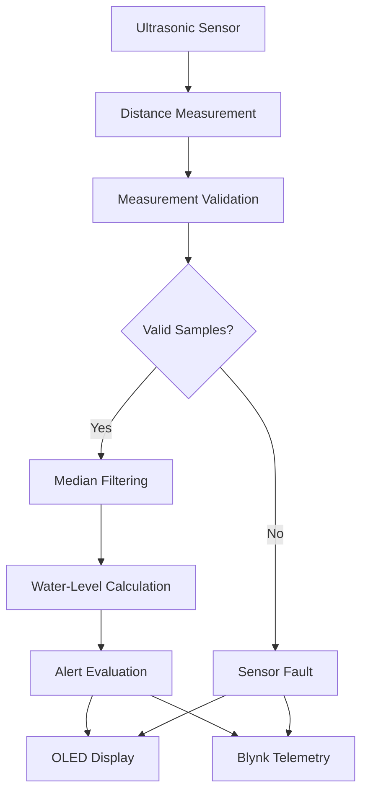

# System Architecture

## Overview

The Flood Detection System uses a modular firmware architecture to separate the major responsibilities of the system.

Rather than placing all functionality inside the main Arduino sketch, the application is divided into individual modules responsible for sensor measurements, alert evaluation, display output, telemetry, and configuration.

This approach makes the code easier to develop and maintain. Individual modules can be updated or tested without requiring extensive changes to unrelated portions of the program.

The main Arduino sketch is responsible for coordinating these modules and managing the overall execution of the system.

## Software Modules

### Configuration — `config.h`

The configuration file provides a central location for the system's operating parameters.

These include:

* ESP32 GPIO assignments
* Sensor mounting height
* Sensor measurement limits
* Flood warning thresholds
* Sensor sampling configuration
* Measurement and communication intervals

Maintaining these settings in one location reduces the need to modify individual modules when the system configuration changes.

Some values are currently based on prototype assumptions and must be verified for the final installation.

### Sensor — `sensor.h` / `sensor.cpp`

The sensor module handles communication with the ultrasonic sensor and converts the resulting distance measurements into water-level values.

Its primary responsibilities include:

* Configuring the trigger and echo pins
* Generating ultrasonic trigger pulses
* Measuring the echo response
* Rejecting invalid measurements
* Collecting multiple samples
* Applying median filtering
* Calculating water level

The sensor module returns a negative value when it cannot obtain a valid measurement. This allows the rest of the application to distinguish a sensor error from an actual water-level reading.

### Alerts — `alerts.h` / `alerts.cpp`

The alerts module evaluates the measured water level against the configured thresholds.

It assigns one of five possible conditions:

| Status       | Description                                      |
| ------------ | ------------------------------------------------ |
| NORMAL       | Water level is below the caution threshold       |
| CAUTION      | Water level has reached the caution threshold    |
| WARNING      | Water level has reached the warning threshold    |
| DANGER       | Water level has reached the danger threshold     |
| SENSOR_FAULT | A valid water-level measurement was not obtained |

The thresholds are defined in `config.h`, allowing them to be adjusted independently of the alert evaluation logic.

The module also provides text descriptions of each status for use in serial output and telemetry.

### Display — `display.h` / `display.cpp`

The display module provides the local user interface through the OLED display.

It initializes the display, presents water-level measurements, and identifies the current warning condition.

When the sensor reports an invalid reading, the display shows an error message rather than presenting the failed measurement as a valid water level.

The current implementation determines its displayed warning label directly from the configured thresholds.

### Telemetry — `telemetry.h` / `telemetry.cpp`

The telemetry module handles communication with the Blynk cloud platform.

Its responsibilities include:

* Initializing the Blynk connection
* Connecting to the configured Wi-Fi network
* Processing Blynk communication events
* Publishing water-level measurements
* Publishing the current alert status
* Reporting connection status

This module separates cloud communication from the measurement and alert evaluation logic.

### Main Application — `flood-detection.ino`

The main Arduino sketch coordinates system initialization and ongoing operation.

During startup, it initializes serial communication, the sensor, OLED display, and telemetry.

Once initialization is complete, the main loop repeatedly checks whether it is time to collect a measurement, update the display, or publish telemetry.

The latest water level and alert status are stored between these operations so they can be reused until the next measurement is collected.

## System Data Flow

The following diagram illustrates the major processing stages.

The measurement process begins with the ultrasonic sensor and produces either a calculated water level or a sensor fault.

Valid measurements are evaluated against the configured thresholds. The resulting information is then available to the display and telemetry modules.

## Program Execution

The application follows the standard Arduino execution model.

### Startup

The `setup()` function runs once when the ESP32 starts.

It initializes the required hardware interfaces and communication services.

### Main Loop

The `loop()` function runs repeatedly during normal operation.

Rather than collecting a measurement during every iteration, the firmware tracks elapsed time using `millis()`.

Three independent timing checks control the major activities:

| Activity             | Default Interval |
| -------------------- | ---------------: |
| Sensor reading       |         2,000 ms |
| Display update       |         1,000 ms |
| Telemetry publishing |        10,000 ms |

These values are defined in `config.h`.

The main loop also calls the telemetry service so that Blynk communication events can be processed.

The current implementation includes blocking delays, so these intervals should be treated as target intervals rather than guaranteed execution periods.

## Design Considerations

### Modularity

The separation of system responsibilities reduces dependencies between major functions.

For example, the sensor module is not responsible for displaying measurements or transmitting data. It produces a water-level value that can be used by other modules.

### Centralized Configuration

Pin assignments, thresholds, and timing settings are defined in `config.h`.

This allows the system to be adapted to different installation conditions without changing the underlying measurement and processing algorithms.

### Error Handling

The sensor module uses `-1.0f` to indicate measurement failure.

This value is recognized by the alert and display logic, preventing an invalid measurement from being treated as a normal reading.

### Future Expansion

The modular architecture allows additional functions to be introduced without redesigning the entire application.

Potential additions include local audible alarms, visual status indicators, rate-of-rise monitoring, and additional communication capabilities.
