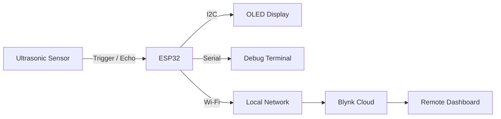

# Communications

## Overview

The Flood Detection System uses several communication interfaces to exchange information between the microcontroller, sensors, display, and remote monitoring platform.

Each interface serves a specific purpose.

| Interface     | Application                                |
| ------------- | ------------------------------------------ |
| Digital GPIO  | Ultrasonic sensor trigger and echo signals |
| I2C           | Communication with the OLED display        |
| UART / Serial | Debugging and diagnostic output            |
| Wi-Fi         | Wireless network connectivity              |
| Blynk         | Remote monitoring and telemetry            |

## Ultrasonic Sensor Interface

The ultrasonic sensor communicates with the ESP32 using two digital signals.

The trigger signal is generated by the ESP32 to initiate a measurement.

The echo signal is returned by the sensor, with the pulse duration representing the measured distance.

The ESP32 measures this duration and converts it into centimeters.

Although this is not a conventional serial communication protocol, it provides a simple digital interface for exchanging measurement information.

## I2C Display Communication

The OLED display communicates with the ESP32 using the Inter-Integrated Circuit (I2C) interface.

I2C uses two signal lines:

* SDA — Serial Data
* SCL — Serial Clock

The current design uses GPIO 21 for SDA and GPIO 22 for SCL.

The U8g2 library handles the display communication and drawing operations.

This allows the firmware to work with text and graphics without manually controlling the individual display pixels.

## Serial Communication

The system uses serial communication primarily for development and troubleshooting.

Serial output is initialized at 115200 baud.

The firmware prints information such as sensor measurements, filtered values, calculated water levels, and system status.

These messages can be viewed through the Arduino IDE Serial Monitor or another compatible serial terminal.

Serial debugging provides a useful way to confirm that the firmware is processing measurements correctly before relying on the display or cloud dashboard.

## Wi-Fi Communication

The ESP32 uses its built-in Wi-Fi hardware to connect to a local wireless network.

The network name and password are stored in `secrets.h`.

These credentials are excluded from the GitHub repository to prevent accidental disclosure.

Wi-Fi connectivity allows the system to communicate with the Blynk cloud platform without requiring a wired connection to a computer.

## Remote Communication

The current firmware uses Blynk to transmit water-level measurements and alert information.

The telemetry module manages the connection and sends information using Blynk virtual pins.

Two datastreams are currently defined:

| Virtual Pin | Data                       |
| ----------- | -------------------------- |
| V0          | Water level in centimeters |
| V1          | Alert status as text       |

The system attempts to publish telemetry at the interval defined in `config.h`.

If the Blynk connection is unavailable when a publication is attempted, the current implementation skips that transmission.

No local telemetry storage or delayed retransmission mechanism is implemented in the reviewed firmware.

## Communication Architecture

The ESP32 acts as the central controller for all communication.

Sensor measurements are processed locally before being displayed or transmitted.

This allows the water-level measurement and local display functions to operate independently of successful cloud telemetry publication.

## Future Considerations

Future development may include improving connection recovery, adding telemetry buffering, or supporting additional monitoring locations.

These improvements could make the system more reliable in environments where wireless connectivity is inconsistent.
